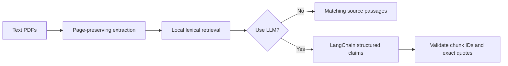

# PageProof

### Read the answer. Check the page.


A document reading desk that pairs PDF questions with page-linked source passages. Search locally, or enable a structured LLM answer with quotations you can inspect.

> **Portfolio release:** initial implementation. Runtime, dependencies, and model behavior have not been tested. The commands below describe intended usage, not verified results.

## What you can explore

| Capability | Implementation |
|---|---|
| Reading desk | Streamlit interface with multi-file uploads and JSON downloads |
| Source traceability | Filename, page, chunk identifier, and exact quotation |
| Offline mode | Ranked passages without sending documents to a provider |
| AI mode | LangChain + Pydantic structured claims; invalid citations are rejected |
| Session controls | Clear uploaded document state without writing PDFs to disk |

## How it fits together



## Quick start

Use Python 3.11 or newer. Run from the repository root. Git is also required for CodeTrail.

```powershell
git clone https://github.com/TanjayaJason/PageProof.git
cd PageProof
python -m venv .venv
.\.venv\Scripts\Activate.ps1
pip install -e ".[ai]"
Copy-Item .env.example .env
```

Skip the copy if `.env` already exists. On macOS/Linux, activate with `source .venv/bin/activate` and copy with `cp .env.example .env`.

```powershell
python examples/create_sample.py
pageproof data/scholarship.pdf "What is the minimum GPA?"
streamlit run app.py
```

## Optional AI mode

Fill `OPENAI_API_KEY` and `OPENAI_MODEL` in your local `.env`. Set `OPENAI_BASE_URL` only when using a compatible endpoint. The endpoint must support tool/function calling. Installing the AI extra does not enable model calls: opt in with `--ai` or the PageProof sidebar toggle.

```powershell
pageproof data/scholarship.pdf "What is the minimum GPA?" --ai
```

Provider calls use a 45-second timeout and no automatic retries. Invalid structured responses are rejected. No API keys are included in this repository.

## Limits you should know

Text PDFs only; no OCR. Five files, 20 MB each, 300 pages per PDF, and two million extracted characters per request. Retrieval is lexical, so cross-language matching and paraphrases may be missed. Exact quote matching establishes provenance, not semantic correctness. PDF parser memory usage is not fully bounded by these input limits.

User input is treated as evidence, never executable instructions. Model output remains advisory. Keep private documents, logs, datasets, repositories, and generated reports out of Git; `data/`, `reports/`, and `.env` are ignored.

## Repository guide

```text
src/pageproof/
  core.py          Domain logic and evidence handling
  cli.py           Command-line entry point
  support.py       Bounded input and optional provider boundary
docs/
  PRD.md           Product scope and acceptance goals
  DESIGN.md        Architecture and implementation decisions
  STATUS.md        Delivery and validation status
.agents/skills/pageproof/SKILL.md
AGENTS.md          Guidance for future coding work
.env.example       Empty configuration template
```

## Where this goes next

- Add bilingual retrieval evaluation and citation-support scoring.
- Consider embeddings after establishing a lexical baseline.
- Add OCR and persistent collections only as separate scoped features.

## Project notes

Read the [PRD](docs/PRD.md), [design](docs/DESIGN.md), and [delivery status](docs/STATUS.md) for scope and tradeoffs. This release intentionally has no evaluation results or benchmark claims. A license has not been selected; no broad reuse rights are implied.
